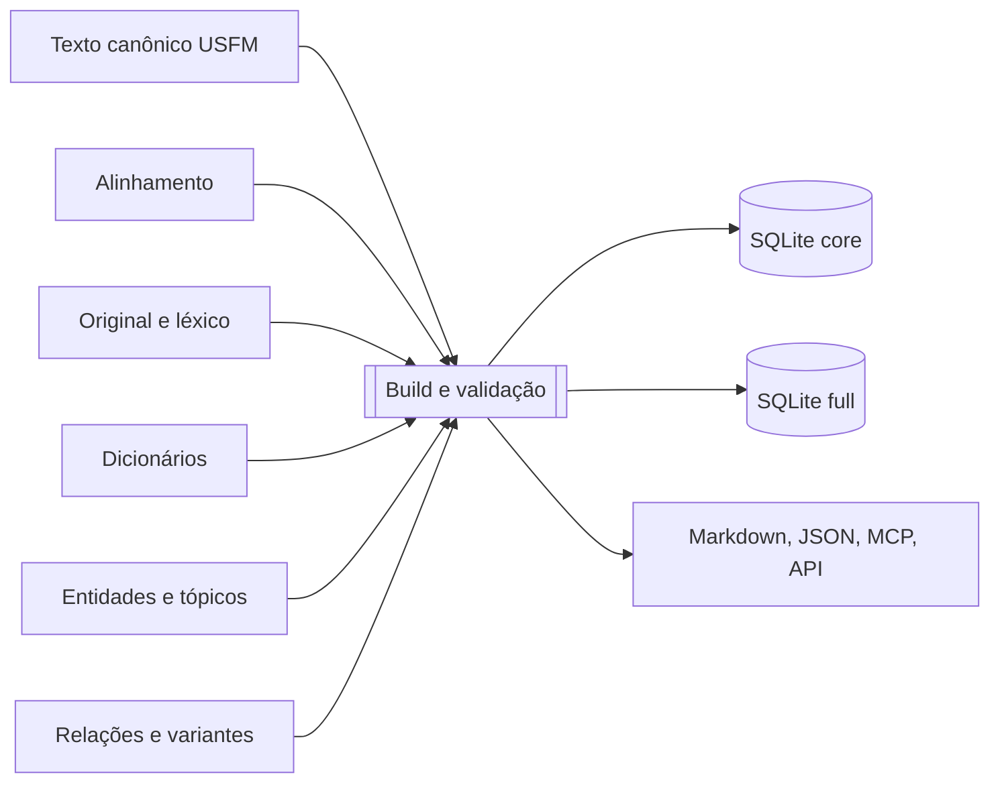
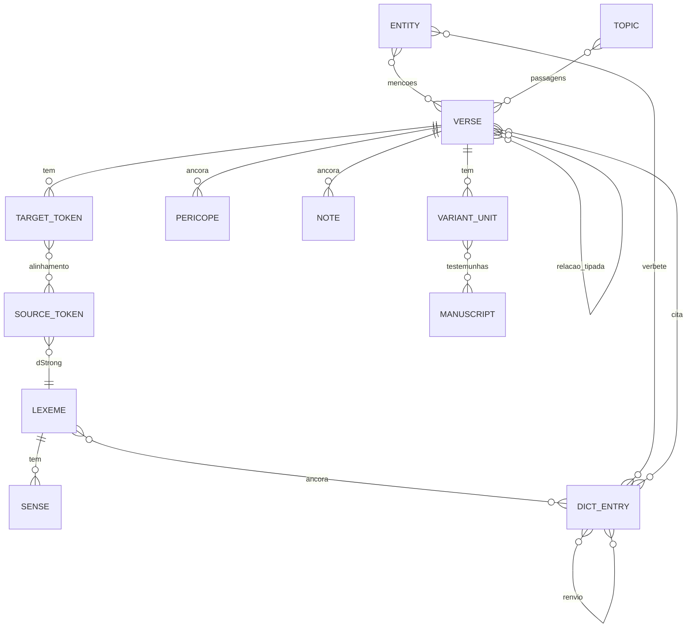

# RFC-0009: Estrutura de dados para Strong, relacionados, léxicos e dicionários

- **Estado:** Proposta
- **Autor(es):** Fundador (rascunho redigido com apoio de IA)
- **Aberta em:** 2026-10-23
- **Decide:** Conselho (no início, o fundador)
- **Fim do prazo de comentários:** 14 dias depois da publicação do repositório

## Resumo

Os livros precisam carregar **números de Strong, versículos relacionados e ligação com léxicos e dicionários**, sem que o texto fique pesado nem frágil. Propõe-se: um **texto canônico completo e limpo**, e **camadas laterais** (alinhamento, léxico, dicionários, entidades, tópicos, relações) **ancoradas por identificadores estáveis**, nunca por posição de caractere. Tudo que é índice ou banco de consulta é **gerado**. Cada dado leva **proveniência, licença e estado de revisão**.

A proposta aproveita o que projetos vizinhos já provaram ([projetos relacionados](../docs/projetos-relacionados.md)): o **Bible Strong** (aplicativo de estudo, código GPL-3.0) separa o Strong do texto e passa tudo por portas de qualidade; o **STEPBible** (dados sob CC BY 4.0) já entrega o original com lema, morfologia, Strong desambiguado, variantes por edição, nomes próprios e versificação.

## Problema

- Se o **Strong vive dentro do texto** (`\w palavra|strong="G25"\w*`), toda correção de tradução pode **quebrar o alinhamento** sem ninguém notar, e o tradutor tem de lidar com marcação que não é dele.
- O **número de Strong clássico é impreciso**: um número serve a vários sentidos e há palavras sem número. Léxicos e dicionários precisam de identidades mais finas.
- **Léxicos e dicionários vêm de fontes e licenças diferentes** (domínio público, CC BY, CC BY-SA). Misturar tudo num arquivo só torna impossível respeitar cada licença.
- Quem consome (apps, IA, API) faz sempre as mesmas perguntas: **toquei numa palavra, o que ela é? Onde mais aparece? Como foi traduzida? Que verbete a explica? Que versículos se relacionam?** A estrutura tem de responder a isso rápido.
- O trabalho é **comunitário**: precisa ser dividido em tarefas pequenas, verificáveis, que não dependam umas das outras.

## Princípios

1. **O texto canônico é completo e válido sem nenhuma camada.** Remover todas as camadas deixa o texto idêntico. Esta é uma **invariante testada em CI**.
2. **Tudo é ancorado por identificadores estáveis e neutros de idioma.** Posições de caractere só existem dentro do alinhamento, protegidas por um hash do texto.
3. **O que é neutro de idioma é separado do que é por idioma.** O original, o léxico (identidade), as entidades, os tópicos e as referências são comuns; glosas, definições, nomes e títulos são de cada idioma.
4. **Todo dado leva proveniência, licença e estado.** Nenhum dado é "correto" só porque um modelo o produziu ou porque já existia em outra base.
5. **A licença é por camada.** O que tem condição (BY-SA) fica em **pacote isolado**, nunca misturado ao texto CC BY.
6. **Índices e bancos de consulta são gerados.** Nunca editados à mão.
7. **Lançamento imutável**, com manifesto, somas de verificação e portas de validação.

## Proposta

### 1. Identificadores

| Objeto | Forma | Exemplo | Observações |
|---|---|---|---|
| Livro | Código USFM de 3 caracteres, com apelido OSIS | `JHN` (OSIS `John`) | Tabela `books` com nomes e abreviações por idioma e a que cânones pertence |
| Verso | `LIV.cap.verso` | `JHN.3.16` | O esquema de versificação é declarado; tabelas mapeiam entre esquemas |
| Passagem | `LIV.cap.verso-LIV.cap.verso` | `JHN.3.16-18` | |
| Palavra do original | `edição:LIV.cap.verso#posição` | `tagnt:JHN.3.16#4` | Posição dentro da edição; estável por versão da edição |
| Palavra da tradução | `versão:LIV.cap.verso#posição` | `bibleme-<versão>-pt-BR:JHN.3.16#5` | Posição na tokenização normativa do verso, protegida por `textHash` |
| Lexema | `lex:<idioma>:<id>` | `lex:grc:G0025` | O `<id>` é o **dStrong** (Strong desambiguado do STEP); cruzamentos com Strong e Strong estendido |
| Sentido | `lex:…:s<n>` | `lex:grc:G0025:s2` | Subsentido, ancorado a exemplos |
| Obra de dicionário | `dw:<slug>` | `dw:easton` | Licença, ano, idioma |
| Verbete | `de:<obra>:<slug>` | `de:easton:abraham` | |
| Entidade | `ent:<tipo>:<slug>` | `ent:person:abraham` | Cruzamento com o TIPNR do STEP |
| Tópico | `top:<slug>` | `top:faith` | |
| Relação | `rel:<hash>` | | Tipo, origem, confiança |
| Manuscrito | `ms:<sigla>` | `ms:GA-01` | |
| Unidade de variação | `var:<verso>[-n]` | `var:JHN.7.53` | |
| Nota ou comentário | `nt:<camada>:<id>` | | |
| Perícope | `per:<versão>:<verso>` | | Início e fim, título por idioma |

Os identificadores são em ASCII, estáveis e **nunca reaproveitados** (um ID aposentado fica como "substituído por").

### 2. Camadas e o que cada uma guarda

#### 2.1 Texto original

Camada neutra de idioma: cada palavra com **lema, morfologia, dStrong, glosa neutra e transliteração**, por edição. Os **textos-base vêm diretamente de OSHB e SBLGNT** e o **STEPBible entra como camada auxiliar, com condições e sem dependência rígida** ([RFC-0001](0001-textos-base.md), decisão do fundador). Fonte dos dados auxiliares: **STEPBible** (TAHOT para o hebraico e aramaico, TAGNT para o grego; CC BY 4.0, conferido no README oficial). O TAGNT marca, **palavra a palavra, em que edições cada palavra aparece** (NA27/28, TR, SBLGNT, Byz, WH e outras), o que dá de graça uma camada de variantes para o Novo Testamento. Ver [RFC-0001](0001-textos-base.md).

#### 2.2 Alinhamento (a camada central)

Liga as **palavras da tradução** às **palavras do original**. É um arquivo lateral por livro e versão:

```json
{
  "verse": "JHN.3.16",
  "version": "bibleme-<versão>-pt-BR",
  "textHash": "sha256:…",
  "source": "tagnt",
  "links": [
    { "t": [3],    "s": ["tagnt:JHN.3.16#7"], "kind": "1:1", "status": "revisado" },
    { "t": [5, 6], "s": ["tagnt:JHN.3.16#9"], "kind": "n:1", "status": "automático", "confidence": 0.82 }
  ],
  "unaligned": { "target": [1], "source": [], "why": "acrescentada" }
}
```

- **Quem edita o texto não edita o alinhamento.** O tradutor cuida só do USFM. O alinhamento é trabalho de outra tarefa, com outra ferramenta.
- **Proteção contra defasagem:** o `textHash` guarda o hash do texto do verso na hora do alinhamento. Se o texto muda, a CI marca o alinhamento daquele verso como **defasado** e o coloca na fila de revisão. Nada fica errado em silêncio.
- **Tipos de ligação:** `1:1`, `n:1` (várias palavras da tradução para uma do original, comum em português com "do", "na", "dar-lhe-ei"), `1:n`, `0:1` (implícita) e `1:0` (acrescentada, ver `\add`).
- **Estados:** `proposto` (máquina ou iniciante) → `automático` (regra) → `revisado` (pessoa com competência) → `contestado`. Dois contratos de saída, como o Bible Strong:
  - **leitura:** só `revisado` (o leitor nunca vê Strong sem base);
  - **avançado:** tudo, com o estado visível.
- **O Strong dentro do USFM publicado é gerado a partir do alinhamento** (`\w palavra|strong="…"\w*`), para quem consome USFM. Para o ecossistema que usa alinhamento embutido (como o unfoldingWord, com marcadores `\zaln`), o projeto pode **exportar** nesse formato.

#### 2.3 Léxico

Neutro na identidade, por idioma nas glosas e definições. Uma entrada por lexema:

| Campo | Descrição |
|---|---|
| `id`, `language` | `lex:grc:G0025`, `grc` ou `heb` ou `arc` |
| `lemma`, `translit`, `pronunciation`, `pos` | Forma original, transliteração, pronúncia, classe |
| `ids` | Cruzamento: Strong, Strong estendido, dStrong, números de outros léxicos |
| `glosses[idioma]` | Lista de glosas curtas, **cada uma com proveniência, estado e licença** |
| `meanings[idioma]` | Definição em texto curto |
| `senses[]` | Subsentidos com exemplos ancorados em versículos |
| `related[]` | Mesma raiz, derivados, sinônimos, antônimos |
| `sources[]` | De onde veio cada campo (obra, versão, licença) |

Fontes candidatas: **STEPBible** (TBESH e TBESG, léxicos em inglês, CC BY 4.0); dicionário de Strong (domínio público, ver [registro de fontes](../docs/registro-de-fontes.md)). As **glosas e definições em português** são produzidas pela equipe do idioma, com proveniência e revisão. Parte do conteúdo do STEP foi **criada com IA e é declarada como tal** pelo próprio projeto; entra com estado `proposto` até ser revisada.

#### 2.4 Ocorrências e distribuição de traduções (geradas)

A partir do alinhamento revisado, o build gera: **todas as ocorrências de cada lexema** (por livro, por sentido, por forma), a **concordância** e a **distribuição de como o lexema foi traduzido** em cada versão ("*agapáō* foi traduzido por *amar* em 80% das ocorrências"). Isso alimenta o painel de palavra e a busca por lema. **Nada disso é escrito à mão.**

#### 2.5 Dicionários

- **Obras** (`dw:`): registradas com idioma, ano, autor e **licença**. Só entram obras de domínio público ou com licença livre, conferidas.
- **Verbetes** (`de:`): cabeça de verbete, idioma e corpo em um subconjunto de Markdown em que **citações bíblicas, lexemas e outros verbetes são âncoras estruturadas**, e não texto solto (`[[JHN.3.16]]`, `[[lex:grc:G0025]]`, `[[de:easton:abraham]]`).
- **Âncoras dicionário-passagem:** ligam um verbete ao versículo que ele cita, e permitem a pergunta inversa: *que verbetes citam este versículo?*
- **Renvios internos** ("ver também"): cada um com **origem** (`fonte`, `sugestão editorial` ou `gerado`) e confiança. Um renvio gerado automaticamente só vale se for conservador (nome corroborado, sem ambiguidade, uma vez por verbete).
- **Correspondências entre obras e idiomas:** grupos de verbetes que tratam do mesmo assunto, **sem fundir os textos** (por exemplo, as várias grafias de *Nabucodonosor*). Cada grupo guarda a regra que o formou.

#### 2.6 Entidades

Pessoas, lugares, grupos, eventos e tempos, com nomes por idioma, parentescos, **menções** (lista de versículos) e, para lugares, **coordenadas** (OpenBible.info Geocoding, CC BY 4.0). Base candidata para pessoas e lugares: **TIPNR**, do STEPBible (CC BY 4.0), que separa cada indivíduo e dá referências exaustivas.

#### 2.7 Tópicos

Assunto para passagens, com relações "ver também". Base candidata: o conjunto de tópicos **NEUU** (CC BY 4.0, derivado de Nave, 1896, e Torrey, 1897, domínio público). Só usaríamos a camada de tópicos e referências; o material "enriquecido por IA" que o conjunto menciona fica de fora até revisão.

#### 2.8 Relações entre versículos (tipadas)

Em vez de uma lista solta de "relacionados", **arestas tipadas**:

| Tipo | Significado |
|---|---|
| `paralela` | Mesma história ou texto (sinóticos, Reis e Crônicas) |
| `citação` | Um texto cita outro (com a **forma citada**: massorético, LXX ou outra) |
| `alusão`, `eco` | Referência indireta |
| `temática` | Mesmo assunto |
| `lexical` | Mesma palavra do original em contextos diferentes (derivada do alinhamento) |

Cada aresta guarda **origem** (OpenBible.info, TSK, curadoria da comunidade), **votos ou confiança** e o tipo. Num trecho, as arestas somam.

#### 2.9 Perícopes, notas, comentários e variantes

Objetos **ancorados por ID de verso** (não por posição): perícopes (início, fim, título por idioma), notas e comentários (autor, tradição, licença) e unidades de variação ([RFC-0003](0003-formato-e-camadas.md)).

### 3. Perguntas que a estrutura precisa responder

A estrutura só está certa se **cada uma** destas consultas for respondida a partir do banco gerado, com índice:

1. **Toquei numa palavra da tradução:** qual o lexema, a glosa e a definição?
2. **Todas as ocorrências** de um lexema, por livro e por sentido.
3. **Como esse lexema foi traduzido** em cada versão (distribuição de palavras).
4. **Dado um verso:** palavras com Strong, relacionados, tópicos, entidades, notas e variantes.
5. **Dado um verbete:** passagens citadas e lexemas ligados.
6. **Dada uma passagem:** que verbetes a citam.
7. **Busca** por lema, dStrong, morfologia, glosa, frase.
8. **Dada uma entidade:** menções, mapa, parentesco.
9. **Dado um tópico:** passagens e tópicos relacionados.
10. **Dada uma variante:** testemunhas e o que muda na tradução.
11. **Comparar** uma passagem com o original e com outra versão (alinhamento contra alinhamento).

### 4. Geração e lançamento



- **Perfis:** `core` (texto, alinhamento revisado, léxico essencial, perícopes, relações) e `full` (acrescenta dicionários, entidades, tópicos, comentários e variantes completas). Pacotes por idioma.
- **Manifesto** de cada release: lista de camadas, **licença de cada uma**, fontes fixadas por versão e soma de verificação, relatórios de cobertura e de semelhança.
- **Portas de validação** (a CI recusa se falhar):
  - o texto sem camadas é **idêntico** ao USFM ("invariante da remoção");
  - todos os IDs resolvem; **zero palavras órfãs** no alinhamento; **zero alinhamentos defasados** nas passagens marcadas como estáveis;
  - contagens de versos conferem com o esquema; o SQLite passa na checagem de integridade;
  - o Strong gerado dentro do USFM **bate exatamente** com o alinhamento revisado.



### 5. Qualidade

- **Avaliação com "ouro mascarado"** (método do Bible Strong): tomamos uma Bíblia **que já tem Strong de confiança**, escondemos o Strong, rodamos as nossas ferramentas e comparamos. Medimos **precisão e revocação do alinhamento** (mesma palavra, mesma ocorrência), separadamente da **semelhança de sobreposição** e do **inventário** (que só mede se achamos os mesmos números, não onde). **Nunca** divulgamos o inventário como se fosse qualidade de alinhamento. Tiramos da referência qualquer edição irmã da avaliada, para não inflar os números.
- **Amostras auditadas por pessoas** em cada release (por exemplo, 10 versículos por livro), com o resultado publicado.
- **Quarentena:** dado em conflito de fonte fica isolado, com o motivo, e não é publicado.
- **IA:** pode **propor** alinhamentos, glosas e renvios (estado `proposto`), com entrada e saída restritas (esquema, referências, validação mecânica). **Nunca publica como `revisado` sem pessoa.** Os mesmos limites da [RFC-0004](0004-processo-e-versoes.md): IA não escreve o texto bíblico.

### 6. Licença por camada

| Camada | Licença-alvo | Observação |
|---|---|---|
| Texto, alinhamento, glosas e definições **nossos** | CC BY 4.0 | Sob a licença do projeto |
| STEPBible (original, léxicos EN, TIPNR, versificação, morfologia) | CC BY 4.0 | Crédito "STEP Bible" com link; registrar as mudanças |
| NEUU Tópicos, OpenBible.info | CC BY 4.0 | Crédito de origem |
| Obras de domínio público (Easton, Smith, Nave e outras) | Domínio público | Conferir a edição digital usada |
| Material **BY-SA** (por exemplo notas e verbetes do Aquifer, que adaptam obras da Tyndale House, e o unfoldingWord) | **BY-SA, em pacote isolado** | Fica **fora** do texto e das camadas CC BY, exportável sob BY-SA, e anunciado como tal. Só entra se uma RFC aceitar |

**Regra:** o manifesto de cada release lista a licença de cada camada, e quem consome decide o que combina. O texto do projeto **nunca** é contaminado por uma camada com condição.

### 7. Gramática de referências

Hoje cada projeto reinventa o leitor de referências (`Rm 8.28`, `romanos 8:28-30`, `1 Co 13`). **Bible::Reference** (Perl) e o leitor do **Bible Strong** resolvem isso, e o app bibleme também tem o seu. Para que todos os consumidores do projeto se comportem igual, propõe-se:

- uma **especificação normativa** (`docs/referencias.md`): forma canônica de máquina (`JHN.3.16-18`), formas aceitas, abreviações por idioma e por tradição, listas e intervalos (inclusive entre capítulos), e o que fazer com ambiguidades (`Jo`, `Js`);
- uma **tabela de livros** com **pertencimento a cada cânone** (protestante, católico, ortodoxo) e a **ordem de cada um**;
- **vetores de teste compartilhados** (entrada, idioma, cânone, saída esperada), para o app, o MCP e a API passarem nos mesmos testes. Não dependemos do código de nenhum desses projetos (Artistic 2.0 e GPL-3.0), só da ideia.

## Alternativas consideradas

- **Strong dentro do USFM como fonte** (era a proposta da [RFC-0003](0003-formato-e-camadas.md)): simples e padrão, mas frágil quando o texto muda e mistura o trabalho do tradutor com o do alinhador. Mantém-se como **saída gerada**.
- **Alinhamento embutido em USFM (`\zaln`) como fonte:** é o padrão do unfoldingWord e vale como **exportação**. Como fonte, deixa o arquivo pesado e difícil de revisar em PR.
- **Banco de dados como fonte:** perde a revisão por diff e a edição por quem não programa.
- **Adotar o Bible Strong:** o código é GPL-3.0 e não pode entrar em um projeto MIT. Usamos as **ideias** (separação, portas, avaliação), nunca o código.
- **Strong clássico como identidade:** impreciso. Usamos o dStrong como identidade e o clássico como cruzamento.

## O que muda para quem

- **Tradutores:** editam só o texto. Não precisam saber de Strong.
- **Alinhadores:** têm uma tarefa pequena e verificável (um verso por vez), com estados e fila de revisão.
- **Equipes de idioma:** produzem glosas e definições com proveniência; herdam o resto.
- **Apps, IA e API:** consomem um SQLite ou JSON com os mesmos IDs e respostas rápidas às onze perguntas.

## Questões em aberto

1. **Resolvida pelo fundador em 23/out/2026:** o **alinhamento em arquivo lateral é a fonte**, e o Strong dentro do USFM é **gerado** a partir dele. Falta a comunidade comentar, em especial sobre a tokenização (questão 3) e o quanto de alinhamento o piloto precisa ter.
2. **dStrong como identidade lexical?** Depende da cobertura do STEP. Para o **Antigo Testamento hebraico e o Novo Testamento grego** ela existe. **Não sabemos de dados equivalentes e livres para os deuterocanônicos** (LXX com lema e morfologia): como alinhá-los?
3. **Tokenização normativa em português** (e em cada idioma): contrações (do, na), próclises e ênclises (`dar-lhe-ei`), hifens, apóstrofos. Define como se contam as posições no alinhamento.
4. **Hash do texto** (`textHash`): qual normalização (Unicode, espaços, pontuação) antes de calcular.
5. **Confirmação do STEP** sobre o que na base vem de edições críticas modernas (NA27/28), que podem ter direitos próprios, apesar da licença CC BY 4.0 declarada para o repositório.
6. **Pacotes BY-SA:** aceitamos distribuir algum, em separado, ou o projeto fica 100% CC BY?
7. **SQLite como formato de release:** tamanho, versionamento, compatibilidade.
8. Quem **mantém glosas e definições** em cada idioma, e com que **quórum de revisão**?
9. **Exportação `\zaln`** já na primeira release?
10. A **gramática de referências** vive neste repositório ou em um à parte, reutilizável?

## Decisão

*(a preencher)*
